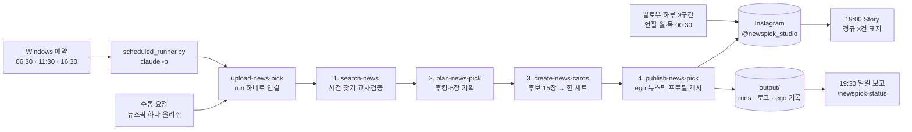

# news_pick_insta

국내 종합 이슈를 검증해 5장 1080×1350 Instagram 카드뉴스로 만들고, `@newspick_studio` 피드와 일일 요약 Story에 게시하는 스킬입니다. 하루 세 번(07·12·17시) 정규 게시를 Windows 예약 작업이 **Claude Code**(`claude -p`)로 돌리고, Instagram 작업은 **ego lite의 `뉴스픽` 프로필**에서 합니다. 팔로우·언팔로 계정을 키우고, 매일 저녁 운영 보고를 남깁니다.

### 스킬 2개

1. **`/newspick-pipeline`**: 본체 스킬입니다. 뉴스를 찾아 검증하고, 카드를 기획·생성해 게시하고 공개 검증까지 합니다. 19시 Story, 팔로우·언팔, 예약 등록도 이 스킬이 맡습니다. "뉴스픽 하나 올려줘", "연예로 하나 올려", "맞팔 아닌 사람 언팔해줘", "12시꺼 정규로 넣어줘"처럼 말해도 이 스킬이 돕니다.
2. **`/newspick-status`**: 보고 스킬입니다. 오늘 회차가 올라갔는지, 실제 ego 프로필, 걸린 시간, 팔로워 증감, 다음 일정, 예약 이상을 보여 줍니다. 기록만 읽고 Instagram은 건드리지 않습니다. "지금 보고", "오늘 올라갔어?"라고 해도 됩니다.

자세한 사용법은 [스킬 사용법](#스킬-사용법)에 있습니다.

---

## 작동 방식



| 언제 | 단계 | 하는 일 |
|---|---|---|
| 06:30 · 11:30 · 16:30 | 0. 예약 시작 | 회차 30분 전에 `scheduled_runner.py`가 Claude Code를 비대화형으로 띄웁니다. `AGENTS.md`에 운영 중지 문구가 있으면 아무것도 하지 않고 끝냅니다 |
| | 1. 뉴스 찾기 (`search-news`) | 회차 lane(07시 연예 48시간, 12시 최근 7일 핫뉴스, 17시 최근 3일 핫뉴스)에서 공개 반응이 큰 사건 후보 3건 이상을 비교하고, 최근 게시와 겹치는 사건은 뺍니다. 언론 원문과 공식 발표, 독립 언론 2곳 이상으로 검증합니다 |
| | 2. 기획 (`plan-news-pick`) | 검증된 사실만으로 첫 장 후킹과 5장 스토리보드(표지 · 본문 3장 · 출처)를 만들고 점수·금지 조건으로 걸러냅니다 |
| | 3. 카드 (`create-news-cards`) | Aside로 기사 사진·공식 화면을 모아 reference로 쓰고, 디렉터 3명 × 5장 = 후보 15장을 동시에 생성해 가장 잘 읽히는 한 세트를 고릅니다. 글자·숫자·표·crop·중복을 검수합니다 |
| | 4. 게시 (`publish-news-pick`) | ego lite `뉴스픽` 프로필에서 4:5 자르기·캡션·AI 라벨을 넣고, 회차 시각 뒤 1~15분 사이 무작위로 공유를 **한 번만** 누릅니다. 공개 페이지에서 5장·비율·캡션·라벨을 확인합니다 |
| 19:00 | 5. Story (`publish-daily-news-story`) | 그날 정규 07·12·17시 표지 3장을 각각 6초 세로 영상으로 만들어 Story 3개로 올립니다. 정규 3건이 다 공개 검증된 날만 합니다 |
| 19:30 | 6. 일일 보고 (`newspick-status`) | 프로필 페이지를 한 번 읽어 팔로워 수를 남기고, 회차 결과·게시 시각·실제 ego 프로필·증감·다음 일정을 목록으로 만듭니다 |
| 08~11시 · 13~15시 · 20~23시 중 무작위 | 7. 팔로우 (`follow-suggested`) | '회원님을 위한 추천' 계정을 하루 40~55명, 2~3개 구간에 나눠 천천히 팔로우합니다 |
| 월·목 00:30 | 8. 언팔 (`unfollow-non-followers`) | 맞팔 아닌 팔로잉을 계정마다 다시 확인하며 천천히 언팔합니다. 팔로우한 지 7일 안 된 계정은 남기고, 06:15에 스스로 멈춥니다 |

1~4단계는 하나의 run(`output/runs/<run_id>`)으로 이어지고, 단계마다 출력 검증이 끝나야 다음 단계로 넘어갑니다. 수동 요청("뉴스픽 하나 올려줘")도 같은 1~4단계를 밟습니다.

---

## 폴더 구조

```text
news_pick_insta/
├── skills/
│   ├── newspick-pipeline/           # 본체 스킬
│   │   ├── SKILL.md                 # 입구: 하려는 일 → 읽을 단계 안내
│   │   ├── upload-news-pick/        # 오케스트레이터, 예약 실행기
│   │   ├── search-news/             # 1단계
│   │   ├── plan-news-pick/          # 2단계
│   │   ├── create-news-cards/       # 3단계
│   │   ├── publish-news-pick/       # 4단계, ego 연결 코드
│   │   ├── publish-daily-news-story/# 19시 Story
│   │   ├── follow-suggested/        # 팔로우, 팔로우·언팔·보고 예약 등록
│   │   └── unfollow-non-followers/  # 언팔
│   └── newspick-status/             # 보고 스킬, daily_report.py
├── scripts/                         # 설치·workspace 초기화
├── docs/                            # 설계와 조사 기록
├── AGENTS.md                        # 운영 기본 설정(운영 위치·ego 프로필 등)
└── output/                          # run·이미지·게시 상태·로그, Git 제외
```

`skills/` 아래에는 생성 이미지, 기사 reference, 게시 job, screenshot, 가상환경을 쓰지 않습니다. 실행물은 모두 `NEWS_PICK_OUTPUT_ROOT`(기본 `output/`)에 모읍니다. `newspick-pipeline` 아래 각 폴더의 `SKILL.md`는 단계 안내이고, 따로 설치하거나 부르는 스킬이 아닙니다.

## 처음 설정

```powershell
git clone https://github.com/csm-kr/news_pick_insta.git
cd news_pick_insta

python scripts/bootstrap.py check            # Python·Pillow·Node·FFmpeg·ego-browser·god-tibo 확인
python scripts/bootstrap.py init --workspace . --account newspick_studio
```

`init`이 만든 `output/workspace.json`의 `browser` 블록에 ego 프로필을 고정합니다. 다른 프로필로 게시되는 사고를 막는 설정입니다.

```json
"browser": { "engine": "ego", "ego_profile_id": "Profile 2", "ego_profile_name": "뉴스픽" }
```

프로필 ID는 `ego-browser nodejs -e "console.log(JSON.stringify(await profiles()))"`로 확인합니다. 이미지 생성 인증·모델은 같은 파일의 `imagegen` 블록(`auth_file`, `model`)에 둡니다.

### Claude Code에서 스킬 쓰기

Claude Code는 프로젝트의 `.claude/skills/`에서 스킬을 찾습니다. 저장소의 두 스킬을 복사하지 말고 정션으로 연결하면 수정이 바로 반영됩니다(`.claude/`는 Git에 올리지 않습니다).

```powershell
New-Item -ItemType Directory -Force .claude\skills | Out-Null
Get-ChildItem skills -Directory | ForEach-Object {
  $link = Join-Path '.claude\skills' $_.Name
  if (-not (Test-Path $link)) { New-Item -ItemType Junction -Path $link -Target $_.FullName | Out-Null }
}
```

이 폴더에서 Claude Code를 열면 `/newspick-pipeline`, `/newspick-status`로 부르거나, 아래 표의 말로 요청하면 됩니다.

## 스킬 사용법

| 하고 싶은 일 | 스킬 | 이렇게 말하면 됩니다 |
|---|---|---|
| 지금 상황 보기 | `newspick-status` | `/newspick-status`, "지금 보고", "오늘 올라갔어?", "다음 일정" |
| 한 건 만들어 올리기 | `newspick-pipeline` | "뉴스픽 하나 올려줘", "연예로 하나 올려줘" |
| 빠진 정규 회차를 수동 게시로 대체 | `newspick-pipeline` | "아침 거 07시 정규로 넣어줘" |
| Story 직접 올리기 | `newspick-pipeline` | "오늘 뉴스 3개 스토리로" |
| 팔로우·언팔 직접 돌리기 | `newspick-pipeline` | "추천 계정 팔로우해줘", "맞팔 아닌 사람 언팔해줘" |
| 예약 다시 걸기·확인 | `newspick-pipeline` | "예약 다시 걸어줘", "예약 상태 보여줘" |

### 지금 보고 (`newspick-status`)

Instagram을 읽지 않고 로컬 기록·ego 연결 상태·예약 작업만 봅니다. 언제 불러도 계정에 부담이 없습니다.

```powershell
$env:PYTHONUTF8 = '1'
python skills/newspick-status/scripts/daily_report.py --status
```

```text
지금 보고 (11/13) · 13:22 기준
- 07:00 ✅ 게시 · 수동 대체 (07:25 시작 → 07:47 게시)
  - ego: 뉴스픽 (Profile 2) · 계정 @newspick_studio
  - 2027 코첼라 라인업에 한국 5팀… · https://www.instagram.com/p/DfqKcOukvp_/
- 12:00 ✅ 게시 (11:30 시작 → 12:07 게시)
- 17:00 ⏰ 예정 (16:30 준비 시작)
- 19:00 스토리 ⏰ 예정
- 팔로워 1,194 (11/12 기준) · 팔로잉 1,468
- 팔로우 18 · 언팔 163 (ego: 뉴스픽 (Profile 2))
- 예약 이상: 없음

걸린 시간: 07:00 22분 (수동 대체) · 12:00 37분

다음 일정 (예약 등록 완료)
- 16:30 17시 회차 준비 → 17:01~17:15 사이 게시
- 19:00 스토리 (정규 3건 공개 검증 시)
...
```

- `ego:`는 설정값이 아니라 게시 직전에 실제로 연결된 프로필입니다(`output/logs/ego-sessions.jsonl`). 기록이 없으면 `기록 없음`.
- `--status` 없이 실행하면 그날 일일 보고를 `output/reports/daily/<날짜>.txt`에 남기고, 프로필 페이지를 한 번 읽어 팔로워 수를 `output/growth/followers.jsonl`에 기록합니다. 매일 19:30 예약 작업이 이 방식으로 돕니다.

### 수동으로 한 건 올리기 (`newspick-pipeline`)

Claude Code에 "뉴스픽 하나 올려줘"라고 하면 `skills/newspick-pipeline/upload-news-pick/SKILL.md`를 따라 새 run을 만들고 검색 → 기획 → 카드 → 게시 → 공개 검증까지 진행합니다. 직접 run을 시작할 때는 다음과 같습니다.

```powershell
$env:NEWS_PICK_OUTPUT_ROOT = (Resolve-Path ./output)
python skills/newspick-pipeline/upload-news-pick/scripts/orchestrate.py init `
  --output-root $env:NEWS_PICK_OUTPUT_ROOT `
  --edition-at <ISO-8601> `
  --account newspick_studio
python skills/newspick-pipeline/upload-news-pick/scripts/orchestrate.py status --run <run-directory>
```

게시 전 마지막 단계에서 payload hash를 잠그고 그 한 건만 승인합니다. 공유는 한 번만 누르고, 실패하면 자동 재시도하지 않고 공개 프로필을 확인합니다.

**정규 회차 대체**: 정규 회차가 빠져서 수동으로 올린 게시를 그 회차로 인정하려면 `output/scheduler/editions/<YYYY-MM-DD>-<HHMM>.replacement.json`을 남깁니다. 19시 Story와 보고가 이 게시를 해당 회차로 셉니다. run 기록(`run.json`)의 시각은 고치지 않습니다.

```json
{ "slot": "07:00", "run_id": "<run 폴더 이름>", "reason": "<대체 사유>", "approved_by": "user" }
```

### 팔로우·언팔 직접 실행

```powershell
$env:PYTHONIOENCODING = 'utf-8'
python skills/newspick-pipeline/follow-suggested/scripts/follow_suggested.py --limit 30          # 추천 계정 최대 30명 팔로우
python skills/newspick-pipeline/unfollow-non-followers/scripts/unfollow_non_followers.py --out-dir output/unfollow/<날짜>          # 대상 목록만 추출
python skills/newspick-pipeline/unfollow-non-followers/scripts/unfollow_non_followers.py --out-dir output/unfollow/<날짜> --apply  # 실제 언팔(몇 시간 걸림)
```

언팔은 계정마다 직전에 맞팔 여부를 다시 확인하고, 1건에 35~60초, 20건마다 10~13분 쉽니다. 다음 예약 게시 15분 전에는 스스로 멈추고, 같은 `--out-dir`로 다시 실행하면 남은 계정부터 이어 갑니다.

### 19시 Story 직접 실행

```powershell
python skills/newspick-pipeline/publish-daily-news-story/scripts/run_daily_story.py --date <YYYY-MM-DD>                                  # 영상만 만들기
python skills/newspick-pipeline/publish-daily-news-story/scripts/run_daily_story.py --date <YYYY-MM-DD> --account newspick_studio --publish  # 게시까지
```

정규 07·12·17시 공개 검증본(또는 대체 기록이 있는 수동 게시)이 정확히 3개일 때만 게시합니다.

## 예약 운영 (Windows)

| 시각 | 작업 | 내용 |
|---|---|---|
| 06:30 · 11:30 · 16:30 | `NewsPickInstagram-0700/1200/1700` | 회차 30분 전에 준비를 시작해 07·12·17시 뒤 1~15분 사이 무작위로 공유. 07시 연예, 12시 최근 7일 핫뉴스, 17시 최근 3일 핫뉴스 |
| 19:00 | `NewsPickInstagram-DailyStory-1900` | 정규 3건이 공개 검증된 날만 Story 3개 |
| 19:30 | `NewsPickDailyReport-1930` | 일일 보고와 팔로워 수 기록 |
| 08:00~10:50 · 13:00~15:30 · 20:00~23:00 중 무작위 | `NewsPickFollow-Morning/Afternoon/Evening` | 하루 40~55명을 2~3개 구간에 나눠 팔로우 |
| 월·목 00:30 | `NewsPickUnfollow-Weekly` | 맞팔 아닌 계정 언팔(팔로우 7일 유예), 06:15에 자동 중단 |

게시 회차는 `scheduled_runner.py`가 Claude Code 비대화형 실행(`claude -p --dangerously-skip-permissions --json-schema …`)으로 네 스킬을 수행합니다. Claude Code 로그인(`claude auth status`)과 ego lite `뉴스픽` 프로필의 Instagram 로그인이 필요하고, ego가 꺼져 있으면 실행기가 켭니다. 모델은 `NEWS_PICK_CLAUDE_MODEL`(없으면 Claude Code 기본 모델), effort는 `NEWS_PICK_CLAUDE_EFFORT`(기본 `high`)로 정합니다.

```powershell
python skills/newspick-pipeline/upload-news-pick/scripts/scheduled_runner.py --slot 17:00 --dry-run      # 실행 명령·프롬프트만 확인
powershell -ExecutionPolicy Bypass -File skills/newspick-pipeline/upload-news-pick/scripts/manage_windows_schedule.ps1 install          # 07·12·17시
powershell -ExecutionPolicy Bypass -File skills/newspick-pipeline/publish-daily-news-story/scripts/manage_windows_story_schedule.ps1 install  # 19시 Story
powershell -ExecutionPolicy Bypass -File skills/newspick-pipeline/follow-suggested/scripts/manage_windows_growth_schedule.ps1 install   # 팔로우·언팔·19:30 보고
powershell -ExecutionPolicy Bypass -File skills/newspick-pipeline/upload-news-pick/scripts/manage_windows_schedule.ps1 status
```

등록 스크립트는 자기가 있는 저장소 폴더를 작업 폴더로 등록합니다. 운영 폴더를 옮기면 새 폴더에서 세 `install`을 다시 실행합니다.

같은 회차 중복 실행, 30분을 넘긴 missed run, QA 실패, 모호한 제출은 자동 게시하지 않습니다. 예약 실행은 `AGENTS.md`를 따르므로, 맨 위에 운영 중지 문구가 있으면 아무것도 하지 않고 `skipped`로 끝납니다. 상태와 로그는 `output/scheduler`, `output/logs/scheduler`에 남습니다.

## 외부 의존성

- Python 3.10 이상과 Pillow, numpy, OpenCV(`opencv-python`)
- Node.js, FFmpeg와 ffprobe
- Claude Code CLI(`claude`), 로그인 상태
- ego lite와 `ego-browser` CLI, `뉴스픽` 프로필에 사용자가 직접 로그인한 `newspick_studio` Instagram 세션
- 공개 뉴스 조사·reference 수집용 Aside CLI
- 카드 이미지 생성용 `god-tibo-gpt-image2-skill`과 Codex 로그인(`~/.codex/auth.json`). 자동 검색되지 않으면 `GOD_TIBO_SKILL_ROOT` 지정

비밀번호·MFA·cookie·`sessionid`는 저장소나 workspace 설정에 기록하지 않습니다. 선택적 Instagram private API 의존성은 `skills/newspick-pipeline/publish-news-pick/requirements.txt`에 있으며, 기본 게시 경로는 ego lite 웹 UI입니다.

Codex로 스킬을 쓰려면 `python scripts/bootstrap.py install`이 두 스킬(`newspick-pipeline`, `newspick-status`)을 `$CODEX_HOME/skills`(기본 `~/.codex/skills`)에 설치합니다. 갱신은 `--update-existing`, 다른 위치는 `--skills-dir`로 지정합니다.

## 검증

```powershell
$env:NEWS_PICK_OUTPUT_ROOT = "$env:TEMP\newspick-test-output"   # 게시 스킬 테스트는 skills 밖 출력 폴더가 필요하다
python -m pytest -q scripts
Get-ChildItem skills -Recurse -Directory -Filter scripts | ForEach-Object {
  Push-Location $_.FullName; python -m pytest -q; Pop-Location
}
```

`output/`, 과거 호환용 `runs/`·`assets/`, 모든 `.local/`, 브라우저 user data와 인증 관련 파일은 Git에서 제외합니다.
